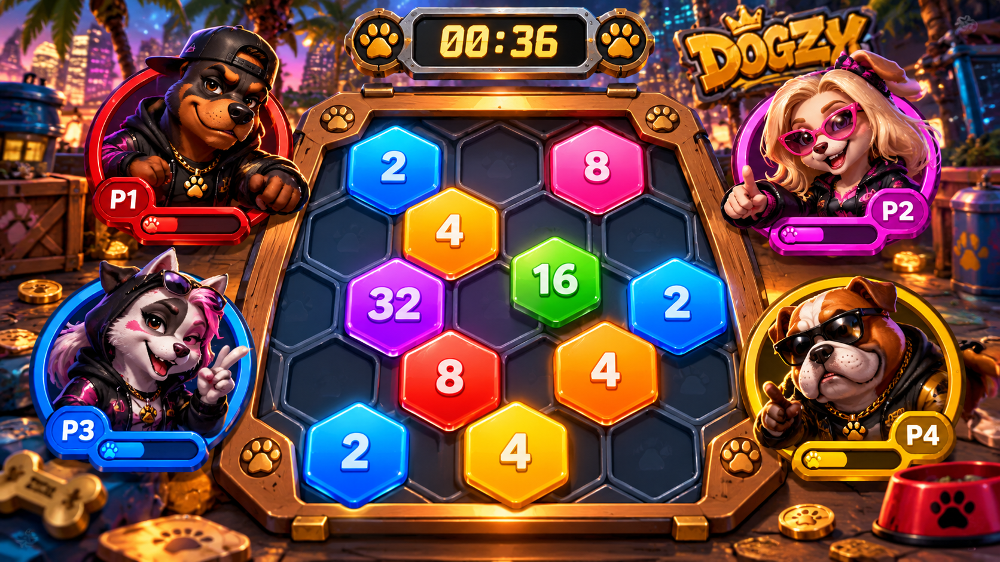
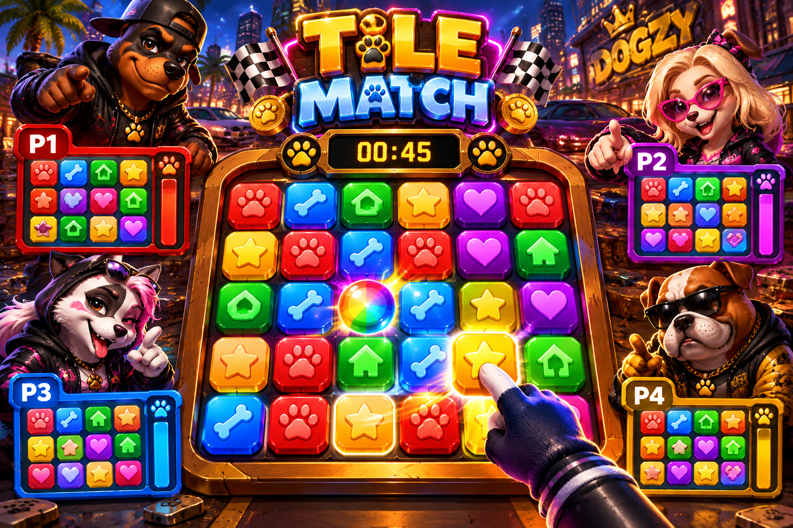

# Dogzy Family Universe – Concept du jeu premium multijoueur

Créatrice : Sania Labbé (Valkyrie)

## 1. En bref
Un jeu de plateau en ligne style Monopoly, version premium et deluxe, pour 4 joueurs, sur cellulaire et ordinateur. L'esprit des attaques vient de Coin Master, mais ici on ne vole pas d'argent : on attaque les commerces des autres joueurs.

## 2. Le tour de jeu
1. Le joueur tourne la roue et avance sur le board de son level (Level 1 à 5).
2. Il applique la case où il arrive : Vide, Bâtiment, Recherche, Quiz, Pièces, Chance, Pénalité, Exploration, Boutique ou Attaque.
3. Quand les 4 joueurs ont joué, il y a un mini-jeu challenge.

## 3. La case Attaque
- Elle déclenche une animation plein écran.
- On voit les commerces de l'adversaire, et on tire au sort le commerce visé et l'arme (bombe, marteau, tornade…).
- Le commerce touché est endommagé ou détruit.

## 4. Réparation et protection (paywall)
- Dégâts légers : le joueur paie la réparation et repart tout de suite.
- Dégâts lourds : le bâtiment tombe, et il faut le rebâtir.
- Le joueur choisit soit de payer pour se protéger avec un bouclier, soit de laisser tomber et d'accepter le risque.

## 5. Les mini-jeux intégrés au board (challenge à la fin de chaque tour)
Les mini-jeux font partie du board : ils se lancent directement pendant la partie.

**Mini-jeu vedette, 2048 en hexagones** : les 4 joueurs Dogzy (P1 à P4) sont autour d'un plateau d'hexagones, avec un minuteur en haut. On fusionne les tuiles de même chiffre (2, 4, 8, 16, 32…) pour faire le plus gros chiffre avant la fin du temps. Chaque joueur a sa barre de progression, et le meilleur score gagne.

- Les 4 joueurs jouent en même temps, chacun sur sa propre map, et ils partent tous au même signal.
- Le premier qui termine gagne.
**Tile Match** : les 4 joueurs Dogzy jouent en même temps, avec un minuteur de 45 secondes. Chacun a sa propre grille de tuiles Dogzy (pattes, os, maisons, étoiles, cœurs) et doit aligner au moins 3 tuiles pareilles pour les faire disparaître. La tuile arc-en-ciel est un bonus. Une barre montre la progression de chaque joueur, et le premier qui vide sa grille gagne.

- Les mini-jeux prévus :
  - **Trace sans lever** : retracer une image d'un seul trait, sans lever le doigt et sans croiser la ligne.
  - **Rush de bulles** : une image se sépare en 4 écrans, et chaque joueur fait éclater les bulles de sa couleur en évitant celles des autres.
  - **Puzzle style Tetris** : placer des pièces pour faire correspondre les images.
  - **2048 hexagones** : voir plus haut.
  - **Tile Match** : voir plus haut.
  - **Mahjong** : associer les tuiles identiques.
  - Ce qui existe déjà et peut servir : la course aux objets cachés et le puzzle d'hexagones.

## 6. La récompense
Le gagnant du mini-jeu reçoit un accessoire gratuit, qui est une image NFT.

## 7. L'évolution des levels
- Il y a 5 levels de métier (exemple : Barmaid, Specialized Barmaid, Head Barmaid, Bar Manager, Bar Owner).
- Il faut les 5 accessoires du level avant de pouvoir évoluer.
- Le gagnant de la partie évolue gratuitement. Les autres paient leur évolution ou refont la même map.

## 8. Le tutoriel
Le tutoriel est intégré dans une partie rapide, avec un mini-jeu dès le début, pour que le joueur apprenne en jouant.

## 9. Propriété
Tous les visuels, personnages et concepts sont créés par Sania Labbé (Valkyrie), qui en est la propriétaire.

© 2026 Sania Labbé (Valkyrie). Tous droits réservés. Reproduction interdite sans autorisation écrite.
